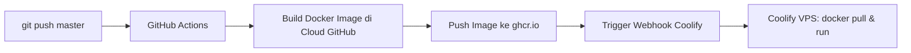

# Panduan Deploy Bacco Backend (CI/CD via GitHub Actions + Coolify)

Arsitektur ini memindahkan **100% proses build & kompilasi Docker ke GitHub Actions** (runner cloud gratis GitHub). Server VPS Coolify **TIDAK PERNAH NGE-BUILD**, hanya melakukan `docker pull` dan menjalankan container dalam hitungan detik.

---

## 1. Alur Kerja (Workflow)



1. Anda melakukan `git push origin master`.
2. **GitHub Actions** (`.github/workflows/deploy.yml`) otomatis berjalan:
   - Mengambil source code.
   - Melakukan `docker build` (Composer install, PHP extensions, Nginx, dll) menggunakan CPU/RAM milik GitHub (gratis 2 Core CPU & 7GB RAM).
   - Mem-push image yang sudah jadi ke **GitHub Container Registry (`ghcr.io/wildan190/bacco-backend:latest`)**.
3. Setelah push image selesai, GitHub Actions memanggil webhook API Coolify.
4. **Coolify di VPS hanya mendownload (pull) image yang sudah jadi lalu me-restart container**.
   - Waktu deploy di VPS: **< 10 detik**.
   - Beban CPU VPS: **0% (tidak ada compile PHP/Composer di VPS)**.
   - Beban RAM VPS saat deploy: **0 MB lonjakan**.

---

## 2. Pengaturan di Coolify

Agar Coolify **tidak pernah mencoba build dari Dockerfile**:

### Jika menggunakan tipe "Docker Compose":
Di `docker-compose.yml`, service `app` sudah diarahkan langsung ke image:
```yaml
services:
  app:
    image: ghcr.io/wildan190/bacco-backend:latest
```
Coolify otomatis hanya menjalankan `docker compose pull && docker compose up -d`.

### Jika menggunakan tipe "Application" di Coolify:
1. Buka resource aplikasi di Coolify.
2. Pada bagian **Build Pack**, pilih **Docker Image** (bukan Dockerfile / Nixpacks).
3. Masukkan nama image:
   ```
   ghcr.io/wildan190/bacco-backend:latest
   ```

---

## 3. Pengaturan Autodeploy & GitHub Container Registry

### A. Matikan Webhook Otomatis di GitHub Repo
Agar Coolify tidak langsung deploy saat push biasa (harus menunggu build di GitHub Actions selesai dulu):
1. Buka repo GitHub: [github.com/wildan190/bacco-backend](https://github.com/wildan190/bacco-backend)
2. Masuk ke **Settings** -> **Webhooks**.
3. Jika ada webhook bawaan yang mengarah ke `coolify.phoenixtech.web.id`, **hapus / uncheck event push**.
4. Di Dashboard Coolify, pastikan opsi **Auto Deploy** posisi **OFF**.

### B. Pastikan Package GHCR Dapat Ditarik oleh Coolify
Secara default, paket baru di GitHub Packages (`ghcr.io`) mungkin berstatus *Private*.
Agar Coolify bisa pull tanpa kendala:
- **Opsi 1 (Paling Mudah)**: Setelah build pertama di GitHub Actions selesai, buka repo GitHub -> klik **Packages** (di kanan halaman repo) -> pilih `bacco-backend` -> **Package Settings** -> ubah visibility menjadi **Public**.
- **Opsi 2**: Atau di Coolify menu **Settings -> Docker Registries**, tambahkan `ghcr.io` dengan username GitHub dan Personal Access Token (PAT).

---

## 4. Alokasi Resource Runtime (Terkunci Sesuai Permintaan)

- **Total RAM**: Terkunci **< 700MB** (App 450MB + Redis 64MB).
- **Total CPU**: Terkunci **< 1.0 Core** (Max 0.70 Core di App).
- **Queue Worker**: 1 Worker (`numprocs=1`), istirahat 1 detik tiap job (`--rest=1`), memory limit 64MB.
- **Redis**: Dibatasi `--maxmemory 48mb` dan policy `allkeys-lru` (RDB snapshot dimatikan agar hemat memori).
